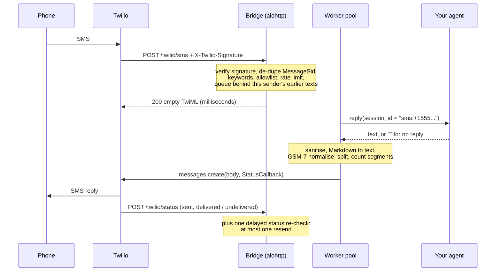
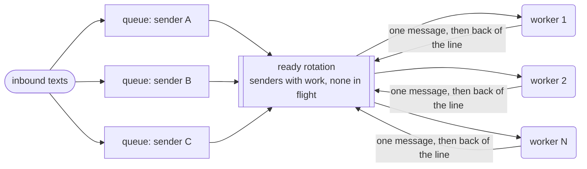

# sms-agent-bridge

**A production SMS front-end for any AI agent.** Put it between a Twilio number and your agent
(any HTTP endpoint, or any OpenAI-compatible model) and it handles the parts of SMS that quietly
go wrong. It answers Twilio in milliseconds and runs each person's conversation strictly in order
while serving many people at once. It keeps replies GSM-7-clean so they cost what they should,
strips internal errors before they reach a phone, and checks that every reply was delivered.


```text
Phone   +1 555 000 0101:  "is repair 1001 ready? and when are you open?"
Twilio  -> bridge:         200 <Response/> in milliseconds; the turn is queued for this sender
Agent   -> bridge:         "**Good news** — repair #1001 is ready. We’re open Tue‑Sat, 9–6, ..."
Bridge  -> phone:          "Good news - repair #1001 is ready. We're open Tue-Sat, 9-6, ..."
                           (GSM-7, 1 segment instead of UCS-2, 2 segments; delivery confirmed
                            by status callback, with one re-check as a safety net)
```

## What's inside

| | |
|---|---|
| **Per-sender order, many senders at once** | One FIFO queue per phone number, drained by a bounded worker pool. A sender's texts are handled one at a time in arrival order, different senders run in parallel, and a worker takes one message per sender per lap, so a chatty sender cannot starve anyone. |
| **Fast acknowledgement, handled once** | Twilio gets an empty TwiML 200 straight away, and the agent runs afterwards. Signatures are checked with the Twilio SDK against the public URL Twilio called. MessageSid de-duplication absorbs Twilio retries and fallback-URL deliveries. |
| **GSM-7-safe text** | Markdown is flattened, typographic lookalikes are mapped to GSM-7 (when that makes the whole message GSM-7), and every part is segment-counted the way carriers pack it. Long replies are split below Twilio's 1,600-character limit at natural boundaries. |
| **No internals on a customer's phone** | Tracebacks, stack frames, exception and log lines, tool-failure notes, internal file paths and credential-shaped strings are dropped or masked at a single outbound choke point. An agent failure becomes a neutral apology, never silence and never the error. |
| **Delivery verification** | Status callbacks plus one delayed status re-check. A delivery failure gets exactly one resend, and none at all for opt-outs, landlines or carrier filtering. |
| **Pluggable agent** | `webhook` (your own agent behind HTTP), `openai` (any OpenAI-compatible `/chat/completions`, with per-sender history) or `echo` for demos. |
| **Guard rails** | Per-sender rate limit and backlog caps with one polite notice per window, carrier keywords (STOP, HELP, ...) kept away from the agent, optional sender allowlist, masked phone numbers in logs, dry-run mode and `/healthz` counters. |
| **Tested without a phone** | 264 tests, all offline. Twilio, the model and your agent are faked. A concurrency proof fires 12 senders at once through the real HTTP app. |

## Architecture



The scheduler ([`scheduler.py`](src/smsbridge/scheduler.py)):



| Module | Responsibility |
|---|---|
| [`server.py`](src/smsbridge/server.py) | aiohttp routes; signature check, admission, de-dupe; wiring and shutdown |
| [`scheduler.py`](src/smsbridge/scheduler.py) | per-sender FIFO queues, fair rotation, bounded worker pool, backpressure |
| [`bridge.py`](src/smsbridge/bridge.py) | one message end to end: agent call and failure policy, compose, send, track |
| [`outbound.py`](src/smsbridge/outbound.py) | sanitise, then plain text, then GSM-7, then split under 1,600, then count |
| [`gsm7.py`](src/smsbridge/gsm7.py) | alphabet, segment counting, lookalike and strict normalisation |
| [`sanitize.py`](src/smsbridge/sanitize.py) | drops diagnostics, masks credentials, falls back to a neutral reply |
| [`delivery.py`](src/smsbridge/delivery.py) | status callbacks, delayed re-check, exactly-once resend |
| [`agents.py`](src/smsbridge/agents.py) | `echo`, `webhook` and OpenAI-compatible backends; per-session history |
| [`twilio_gateway.py`](src/smsbridge/twilio_gateway.py) | Twilio SDK calls in a thread with a 10 s deadline, so a dead connection fails one send instead of holding a worker; dry-run stand-in |
| [`dedupe.py`](src/smsbridge/dedupe.py), [`ratelimit.py`](src/smsbridge/ratelimit.py), [`phone.py`](src/smsbridge/phone.py) | MessageSid claims, sliding window, keywords and number masking |

### The parts that are harder than they look

**1. Per-sender order is a correctness property, not a nicety.** An agent turn reads the
conversation history and then appends to it. If two turns for the same person run
concurrently, both read the same history, and the second answer is written as if the first
exchange never happened: a lost update. Replies can also land out of order. So the scheduler
gives each sender a deque and keeps a FIFO "ready" rotation of senders that have work and
nothing in flight. A worker takes one message, marks the sender in flight and handles it, then
puts the sender at the back of the rotation if more is waiting. A message that arrives while
its sender is busy just waits in the deque. Different senders still run in parallel, up to the
pool size. [`test_concurrency.py`](tests/test_concurrency.py) fires 12 senders × 3
back-to-back texts at the same moment through signed HTTP into the real app and the real
OpenAI-compatible backend. The fake model answers *only* from the history it is sent, so a
leaked word, a wrong message count or a reordered reply fails the test. A control run with a
deliberately shared session fails the same checks, and so does a scheduler mutant that lets a
sender into the rotation twice.

**2. Acknowledge first. Claim the MessageSid, and release it if the hand-off fails.** Twilio
waits up to 15 seconds for a webhook, and agent turns routinely take longer. So the reply never
happens inside the webhook: it is validated, admitted, queued and acknowledged in milliseconds.
The same message can still arrive twice: Twilio retries a webhook once by default on
connection failures (more with connection overrides), and a Fallback URL receives it again
when the primary fails. Every copy has the same MessageSid, so `claim()` checks and records it
in one step. If queueing then fails, the SID is released and Twilio gets a 503, so the retry or
the fallback can still deliver the message instead of it being dropped as a "duplicate". The
SID cache evicts the oldest entry one at a time. Clearing it when full would let every retry
then in flight through as a duplicate reply. Signatures are computed over the URL *Twilio*
called, query string included. Behind a tunnel or proxy, this process sees
`http://127.0.0.1:8080/...`, so the URL is rebuilt from `PUBLIC_BASE_URL`.

**3. One character can triple the bill.** A message is GSM-7 (160 septets, or 153 per part)
only if *every* character is in the GSM 03.38 alphabet. One curly apostrophe, non-breaking
hyphen (U+2011) or tab silently switches the whole message to UCS-2 (70 units, 67 per part). In
the test suite, a 140-character reminder with a single U+2011 is 3 segments. After
normalisation, it is 1. Counting is subtle too. Extension characters (`€ [ ] { } ^ ~ | \`)
cost two septets, and that pair is never split across parts. In UCS-2, emoji are surrogate
pairs that cost two units and are never split either. Normalisation is applied only when it
makes the *whole* message GSM-7. A reply that needs UCS-2 anyway (emoji, non-Latin scripts) is
sent exactly as written, because rewriting it gains nothing and can even make it longer: "…" is
one unit, "..." is three. `strict` mode transliterates and drops instead, and always produces
GSM-7. Twilio rejects bodies over 1,600 characters (error 21617), so long replies are split at
the best boundary available (paragraph, line, sentence, word), measured in UTF-16 units.

**4. Failure is not silence, and an error is not a reply.** The agent contract makes silence
explicit: an empty reply, `NO_REPLY` or HTTP 204 means "nothing to say". Everything else that
goes wrong raises:

- an HTTP error;
- an empty or malformed body (a proxy's empty 200, for example);
- an empty completion;
- a backend that returns something other than text.

A transient failure is retried once. A timeout is *not*: the task is genuinely too long, and a
second full wait only doubles the delay before the same outcome. Either way, the sender gets a
neutral message.

A timeout ends the wait, not the turn. A remote agent usually keeps working after the bridge
hangs up, so the sender's next text could reach it mid-turn: the lost update from point 1.
Instead the timed-out call stays open, and the sender's next text waits until the agent answers
(the late answer is dropped) or until `AGENT_TURN_LIMIT_SECONDS`, when the call is closed. The
`echo` and `openai` backends keep their state inside the bridge, so cancelling them really does
end the turn, and they are cancelled at the timeout.

On the way out, the sanitiser drops whole diagnostic lines (tracebacks with their frames,
exception and log lines, tool-failure notes, raw JSON error bodies, internal paths) and masks
credential-shaped strings inside otherwise normal lines. If nothing meaningful is left, the
fallback reply goes out instead. The rules are anchored and specific. "Your payment failed -
please update your card" and `https://example.com/var/files/report.pdf` are ordinary replies,
and the tests pin both sides of that line.

**5. Delivery has two observers and one resend.** `messages.create` succeeds when Twilio
*queues* a message. Carrier failures arrive minutes later as `undelivered` or `failed`. The
bridge watches through status callbacks and one delayed re-check of the Message resource. The
re-check covers callbacks that were lost, never configured or never sent: Twilio sends none
for a message's initial status. Reports can be duplicated or arrive out of order, and the first
callback can even be handled before the code that sent the message has recorded its SID. Such
early reports are buffered and applied when tracking starts. A report is applied only if it
moves the message forward, so the first final status wins. The check-and-mark runs with no
`await` in between, so a callback and a re-check that see the same failure trigger one resend,
not two. Weakening that comparison from `<=` to `<` fails two tests. A resend is never resent.
Errors where resending cannot help are not resent at all: an opt-out (21610, 30630), a landline
(30006), carrier filtering (30007) or an unregistered A2P sender (30034). A message still in
flight at re-check time is marked unconfirmed and left alone, because resending something that
is merely slow would deliver it twice.

## Quick start

Requirements: Python 3.11+. For live traffic you also need a Twilio number and a public HTTPS
URL that reaches this machine (a tunnel such as `cloudflared` or `ngrok`, or a reverse proxy).

```bash
cd sms-agent-bridge                    # a clone of this repository
python -m venv .venv && source .venv/bin/activate     # Windows: .venv\Scripts\activate
pip install -e ".[dev]"
```

### Try it locally: no Twilio account, nothing sent

```bash
python examples/concurrency_demo.py    # 8 phones at once, in-process; prints what each received
```

```text
8 phones x 3 texts, all at once, 3 workers

+*******0100  (1) noted: apples-0  |  (2) noted: apples-0, bread-0  |  (3) noted: apples-0, bread-0, coffee-0
+*******0101  (1) noted: apples-1  |  (2) noted: apples-1, bread-1  |  (3) noted: apples-1, bread-1, coffee-1
...
in order, no cross-talk: yes
peak agent turns at once: 3 (pool size 3)
wall time 0.88s for 2.37s of agent work
```

Run the real server in dry-run mode (replies go to the log) and drive it with signed webhooks:

```bash
sms-agent-bridge serve --env-file examples/dry-run.env      # terminal 1
python examples/simulate_twilio.py                          # terminal 2: 3 phones, signed
python examples/simulate_twilio.py --unsigned --phones 1    # rejected with 403
```

See how any reply would be sent:

```console
$ sms-agent-bridge inspect "**Good news** — repair #1001 is ready. We’re open Tue‑Sat, 9–6, and we’ll text you if anything changes before your pickup on Friday."
input     UCS-2  2 segments  132 units  forced by U+2014 EM DASH, U+2019 RIGHT SINGLE QUOTATION MARK, U+2011 NON-BREAKING HYPHEN, U+2013 EN DASH
outbound  GSM-7  1 segment  1 part

part 1/1 (GSM-7  1 segment  128 units):
Good news - repair #1001 is ready. We're open Tue-Sat, 9-6, and we'll text you if anything changes before your pickup on Friday.
```

### Connect a real number

```bash
cp .env.example .env    # Twilio credentials, PUBLIC_BASE_URL, AGENT_BACKEND
sms-agent-bridge serve --env-file .env
```

In the Twilio console, set the number's **"A message comes in"** webhook to
`POST https://<your-public-host>/twilio/sms`. Status callbacks are requested per message, at
`/twilio/status`.

### Plug in your agent

With `AGENT_BACKEND=webhook`, each message is POSTed to `AGENT_WEBHOOK_URL` as
`{"session_id", "from", "text", "message_sid", "media"}`, with `Authorization: Bearer
$AGENT_WEBHOOK_TOKEN` when a token is set. Answer `{"reply": "..."}`. An empty reply, `null` or
HTTP 204 sends nothing. Key your agent's memory by `session_id`: it is one per phone number.
While your agent is answering a number's message, that number's next message waits. After
`AGENT_TIMEOUT_SECONDS` the sender gets `TIMEOUT_REPLY`, but the request stays open until you
answer (that late answer is not sent) or until `AGENT_TURN_LIMIT_SECONDS`, when the bridge
closes it and moves on, so stop work on a request whose connection has closed.
[`examples/agent_webhook_server.py`](examples/agent_webhook_server.py) is a complete,
runnable one for a fictional bike shop. Put LangGraph, the OpenAI Agents SDK, the Claude Agent
SDK or anything else behind the same contract.

With `AGENT_BACKEND=openai`, the bridge talks to any OpenAI-compatible `/chat/completions`
endpoint (`OPENAI_BASE_URL`, `OPENAI_API_KEY`, `OPENAI_MODEL`). It keeps the last
`HISTORY_TURNS` exchanges per sender. Failed turns are not recorded, so a retry is not stacked
on top of them.

## Configuration

| Variable | Default | |
|---|---|---|
| `TWILIO_ACCOUNT_SID` / `TWILIO_AUTH_TOKEN` | required | the SID is not needed with `DRY_RUN=true` |
| `TWILIO_FROM_NUMBER` or `TWILIO_MESSAGING_SERVICE_SID` | one is required | not needed with `DRY_RUN=true` |
| `PUBLIC_BASE_URL` | required | the `https://` address Twilio calls; signatures are checked against it (a path prefix is fine) |
| `AGENT_BACKEND` | required | `echo`, `webhook` or `openai` |
| `AGENT_WEBHOOK_URL` / `AGENT_WEBHOOK_TOKEN` | - | webhook backend; the token is sent as a Bearer token |
| `OPENAI_BASE_URL` | `https://api.openai.com/v1` | any OpenAI-compatible endpoint |
| `OPENAI_API_KEY` / `OPENAI_MODEL` | - | required for `openai` |
| `SYSTEM_PROMPT` / `HISTORY_TURNS` | short plain-text SMS persona / `12` | `openai` backend |
| `AGENT_TIMEOUT_SECONDS` | `120` | per attempt; the sender then gets `TIMEOUT_REPLY`, and a timeout is never retried |
| `AGENT_TURN_LIMIT_SECONDS` | `600` | a timed-out `webhook` call stays open, holding the sender's next text, until the agent answers or this long after it started |
| `WORKERS` | `8` | agent turns in flight at once |
| `MAX_QUEUED_PER_SENDER` / `MAX_QUEUED_TOTAL` | `10` / `1000` | backlog caps; overflow gets one busy notice per window |
| `RATE_LIMIT_MESSAGES` / `RATE_LIMIT_WINDOW_SECONDS` | `10` / `60` | per-sender sliding window; `0` disables it |
| `ALLOWED_SENDERS` | - | comma-separated numbers; empty means anyone |
| `GSM_MODE` | `lookalikes` | `lookalikes`, `strict` (always GSM-7, lossy) or `off` |
| `MAX_REPLY_PARTS` | `3` | messages per reply, each at most 1,600 characters |
| `STATUS_RECHECK_SECONDS` | `30` | delay before the status re-check; `0` disables it |
| `RESEND_ON_FAILURE` / `RESEND_SUFFIX` | `true` / - | one resend after `undelivered`/`failed`; the suffix is added only if it still fits |
| `FAILURE_REPLY` / `TIMEOUT_REPLY` / `BUSY_REPLY` | built-in, GSM-7 | sent instead of an error, after a timeout, and when over the limits |
| `DRY_RUN` | `false` | log replies instead of sending them |
| `VALIDATE_TWILIO_SIGNATURE` | `true` | disable only for local experiments |
| `HOST` / `PORT` / `LOG_LEVEL` | `127.0.0.1` / `8080` / `INFO` | |

## Testing

```bash
pytest                              # 264 tests, ~4 s, no Twilio, model or network beyond localhost
ruff check src tests examples
```

[`tests/fakes.py`](tests/fakes.py) provides the doubles:

- an in-memory messaging gateway that records sends and serves scripted statuses. Its status
  lookups can be parked on an event, so a test lands a status callback *while* a re-check is
  mid-flight, deterministically;
- a stub of the Twilio SDK client, which can also hang a call the way a dead connection does;
- a scripted agent.

Webhook and model backends are tested against local aiohttp servers, including one that drops
the connection mid-request. HTTP routes are exercised with real Twilio signatures from the
SDK's `RequestValidator`. CI also runs the concurrency demo and the `inspect` command.

## Security notes

- **Signatures are on by default** and checked against `PUBLIC_BASE_URL`. Requests that fail get
  a 403 before anything else happens.
- **Secrets stay out of logs.** Tokens and keys are hidden from the settings `repr`. Phone
  numbers are masked in logs (`+*******0101`). Message text is not logged, except the outgoing
  reply in dry-run mode.
- **The sanitiser is a safety net**, not a substitute for agent-side hygiene. It removes known
  shapes of leaks; it cannot recognise arbitrary sensitive prose.
- **Isolation needs both sides.** The bridge gives every number its own `session_id`, and does
  not start a number's next turn while the agent is still answering its previous one, even
  after a timeout. A webhook agent must key its memory by that id, and should stop work when its
  caller disconnects: a call still running at `AGENT_TURN_LIMIT_SECONDS` is closed, and the
  sender's next text can then go ahead.
- **`ALLOWED_SENDERS` is a filter, not authentication**: SMS sender IDs can be spoofed.
- **`/healthz` is unauthenticated.** It returns counters only, no message data.
- **State is in memory and per process**: queues, the MessageSid cache and `openai` histories.
  A restart drops messages that were acknowledged but not yet answered. Run one instance per
  number, or route each sender to a fixed instance.

## Roadmap

- Durable inbox and shared de-dupe (SQLite or Redis), so acknowledged messages survive restarts
  and several replicas can share a number
- Media hooks for MMS (download, transcription, vision); today the media URLs are passed to
  the agent
- Send-time retry with backoff for Twilio 429s
- Other channels (WhatsApp, RCS) through the same pipeline, with their own length rules
- Prometheus metrics alongside `/healthz`

## License

MIT
